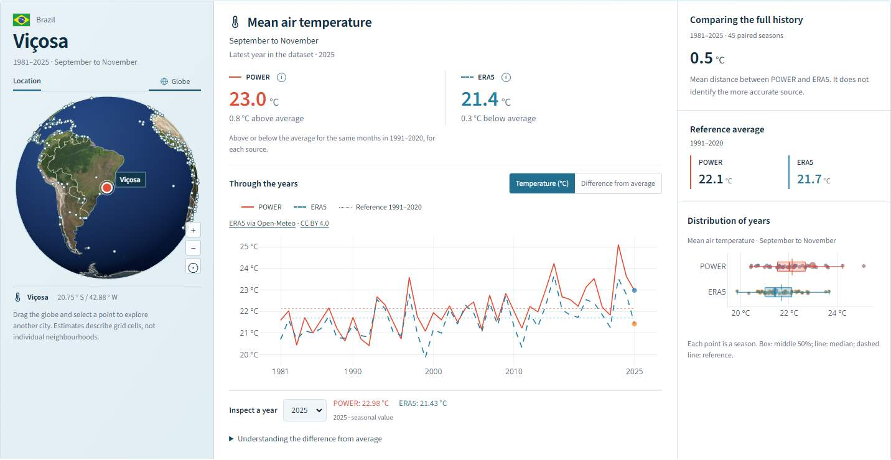
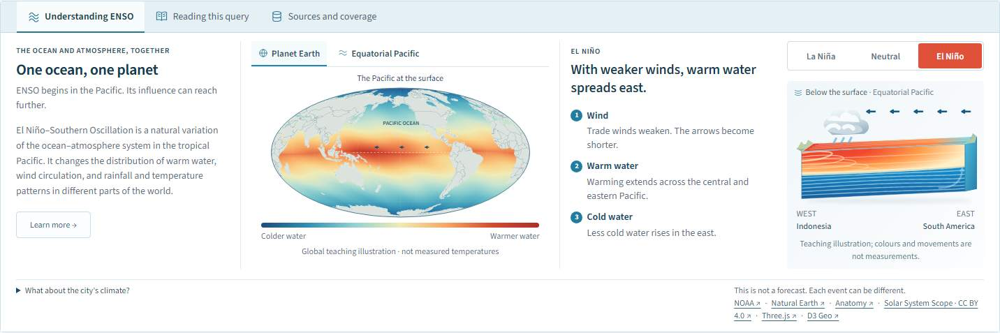
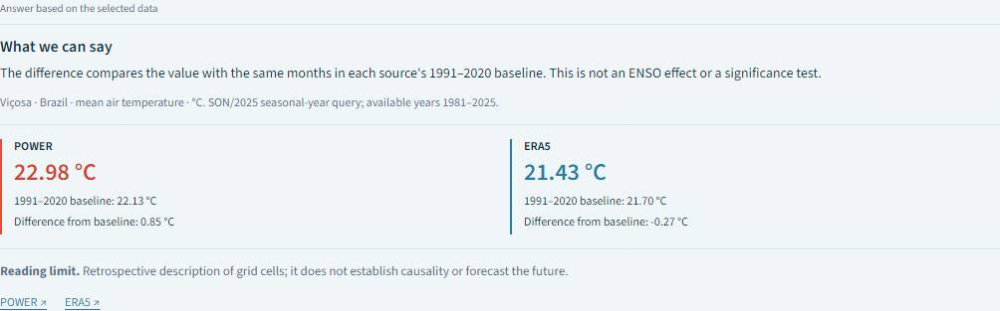
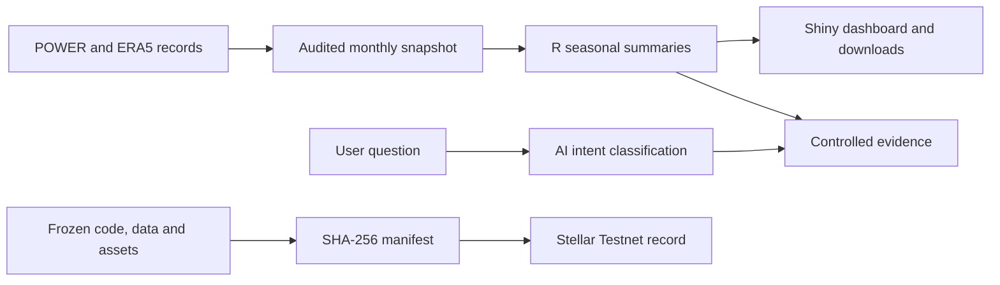
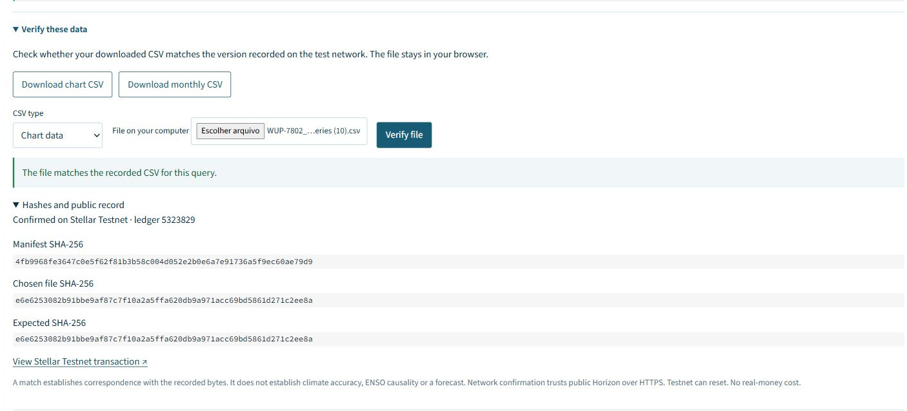
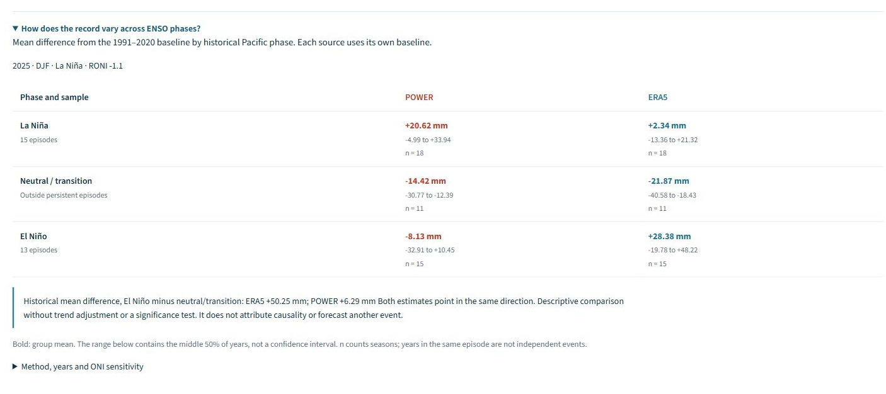

# ENSO Local

### Local climate history. Two sources. Evidence you can inspect.

Explore temperature and rainfall for **684 locations**, compare **NASA POWER and ERA5**, ask about the selected data and download the evidence behind the chart.

**[Open the dashboard →](https://kl5ug0-adriano-pires.shinyapps.io/enso-local-preview/?lang=en)** · [Português](https://kl5ug0-adriano-pires.shinyapps.io/enso-local-preview/?lang=pt) · [Releases and integrity proofs](https://github.com/driano1221/enso-local-impact-explorer/releases)



## One place, three ways to explore

| Explore | What you can do |
|---|---|
| Compare climate history | Select a place, measure and three-month season. Inspect the same year in the line chart and distribution, by pointer, keyboard or touch. |
| Ask a question | Open the optional AI evidence interpreter. See a reviewed explanation, actual source values, baselines and a scientific limit. |
| Explore ENSO phases | Compare historical seasonal anomalies during El Niño, La Niña and neutral/transition conditions, with counts and the middle 50% of years. |
| Check the evidence | Download a chart or monthly CSV and verify it locally in the dashboard against the hash index anchored on Stellar Testnet. |

**1981–2025 · 684 POWER + 684 ERA5 locations · 738,720 monthly records · English / PT-BR · Light / dark**

These are historical grid estimates, not today's weather, municipal averages or local forecasts. The published world dashboard does not establish an El Niño cause. Thirty-nine country/territory population-ranking or boundary cases remain unresolved; unapproved candidate locations are excluded. Coverage of the 684 approved points is complete in both sources. See [the snapshot](SNAPSHOT.json) and [scientific limits](docs/RUNBOOK.md#what-the-numbers-mean).

## From the Pacific to local questions

The interactive Earth and ocean section explains neutral conditions, El Niño and La Niña. Its colours and movement are **didactic illustrations, not measured ocean temperatures**.



## AI that stays with the evidence

The optional interpreter uses DeepSeek Flash for constrained intent classification. R validates the result and displays reviewed evidence using the inspected year, including historical extreme years and the years with the largest source differences. Unsupported questions receive a clear scope message. It does not browse the web, invent forecasts or replace scientific inference. The server keeps the key private; requests require the user's explicit Ask action. The ordinary dashboard works without an API key. Availability through 8 November 2026 depends on the demonstration balance and provider.





In **Verify these data**, choose the downloaded CSV and check it. The browser calculates SHA-256 locally, verifies the CSV hash index against its manifest, and checks the manifest digest in the public Stellar Testnet transaction. Your file is not uploaded. Chart and monthly CSVs are covered for all 684 locations in PT/EN; editing or re-saving a CSV changes its bytes and can invalidate the match. This verifies correspondence with the recorded files, not climate accuracy, authorship, ENSO causality, new AI replies or ongoing server state. The check trusts the public Horizon HTTPS endpoint; Testnet can reset. The full software release has its separate matching proof. [Verification details](docs/RUNBOOK.md#reproduce-and-verify).

The new ENSO summary uses the archived NOAA RONI index to group seasons into persistent El Niño, La Niña and neutral/transition conditions. ONI is available as a sensitivity view. The table reports **descriptive means, quartiles and counts**, not confidence intervals or significance tests. Climate trends and other factors can confound differences; years in one episode and the two climate sources are not independent replications.





## Run locally

Use R 4.3 or newer. From the repository or extracted release root:

```r
install.packages("renv", repos = "https://cloud.r-project.org")
dir.create(".r-library", showWarnings = FALSE)
renv::restore(project = getwd(), library = file.path(getwd(), ".r-library"), prompt = FALSE)
.libPaths(c(file.path(getwd(), ".r-library"), .libPaths()))
source("run.R")
```

Once dependencies are available, `Rscript run.R en 8080` or `Rscript run.R pt 8081` starts a language-specific local view. Keep the whole repository together. Bundled data are read locally; installation and optional AI need internet. No data acquisition starts when the dashboard is opened.

**[Full runbook: installation, hosting, tests, provenance and limits](docs/RUNBOOK.md)** · [AI configuration and privacy](ia/README.md)

## Reproduce, report and contribute

- `python verificar_pacote.py` checks the files listed in the frozen manifest. Do not regenerate it to hide a mismatch.
- R checks cover the reader, interface, PT/EN equivalence and the asynchronous evidence interpreter. See [test commands](docs/RUNBOOK.md#reproduce-and-verify).
- Open an [issue](https://github.com/driano1221/enso-local-impact-explorer/issues) with the selected locality, measure, season, language and reproduction steps. Never include API keys or personal data. [Contribution guide](CONTRIBUTING.md).

**Adriano Pires Cunha** · IEEE ClimateChain Global Hackathon · Climate Data & Environmental Monitoring.

Original code: [MIT](LICENSE). Data and bundled resources retain their own licences: [credits and attribution](CREDITS.md). No endorsement by the data providers is implied. The competition draft has not been submitted; this is a public prototype.
