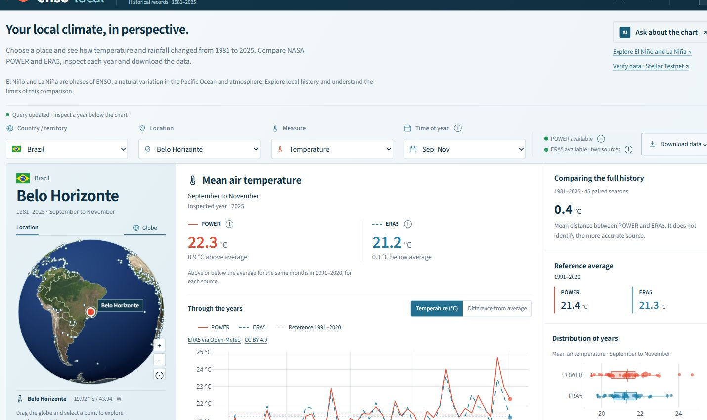
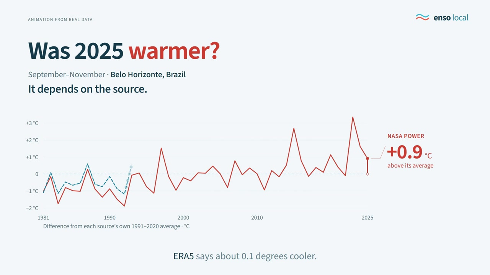
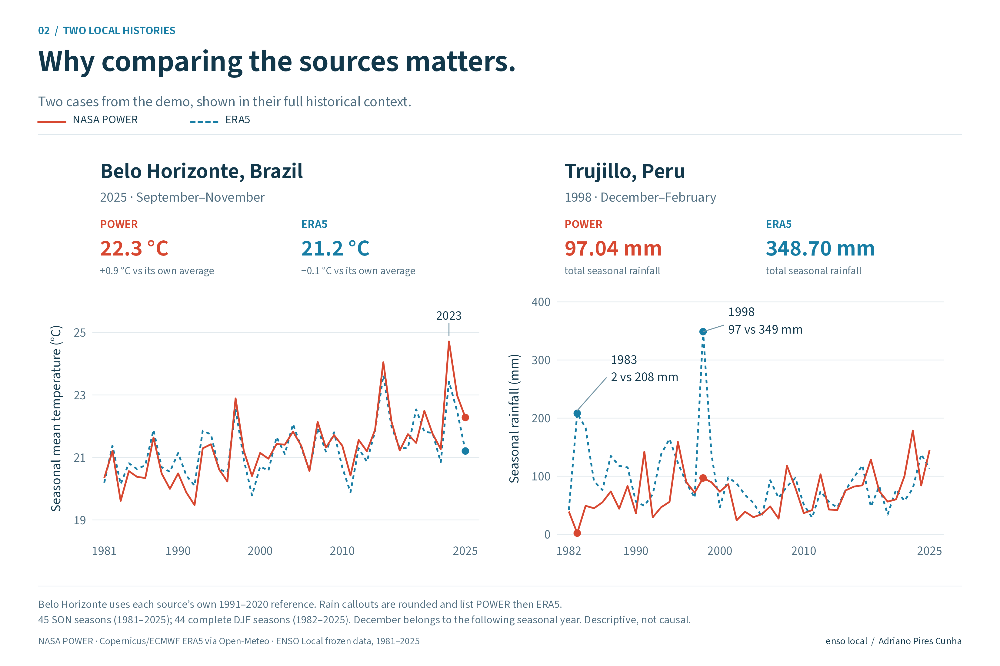
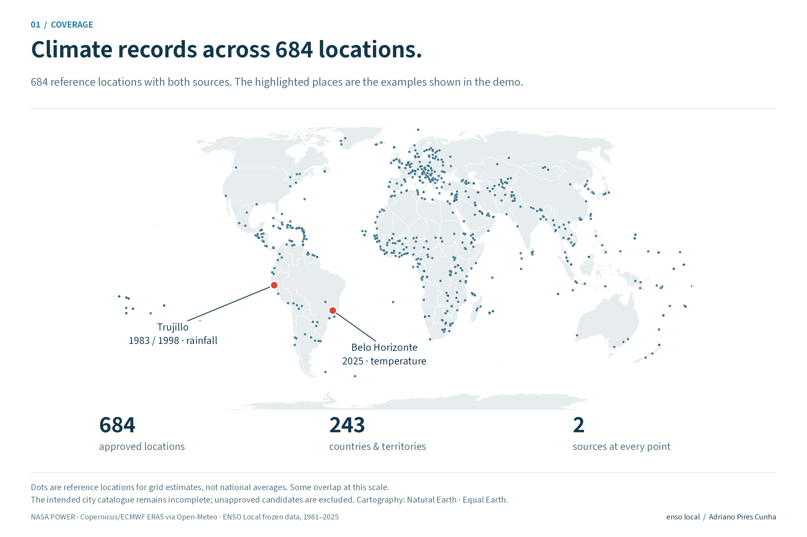
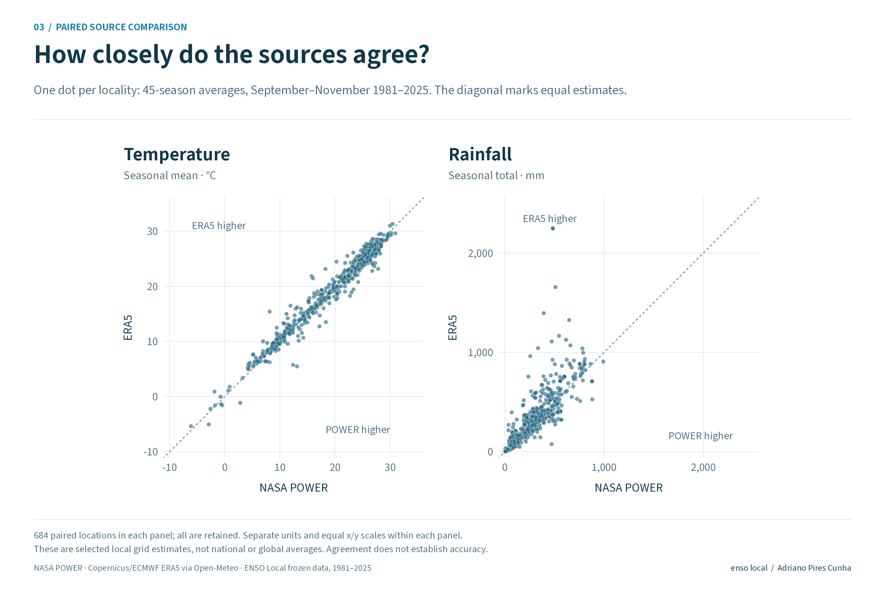
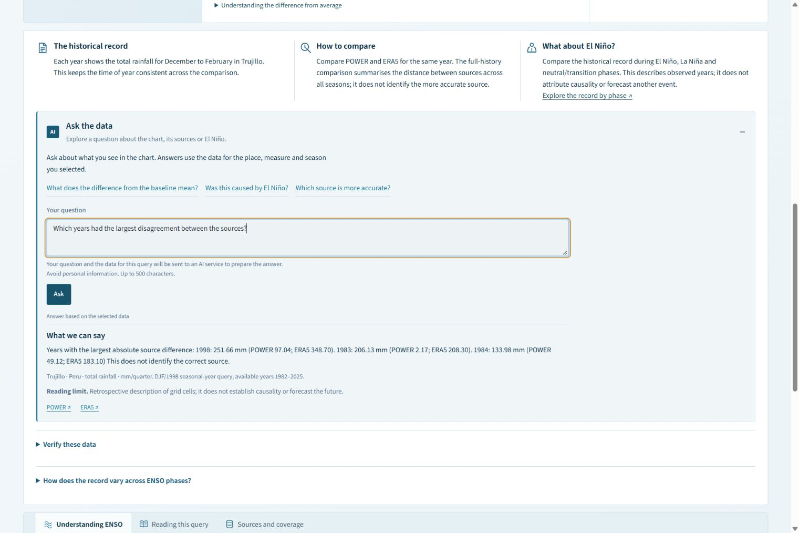
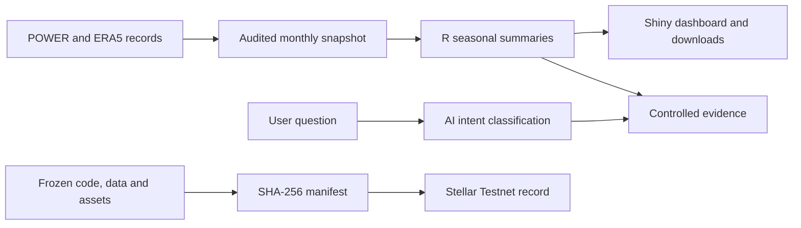
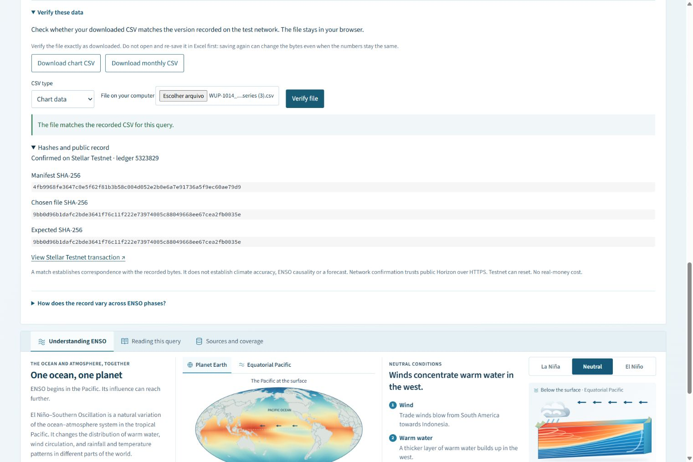

# ENSO Local

Compare temperature and rainfall histories for **684 locations**, explore El Niño and La Niña, and check the files behind the charts.

**[Open the dashboard →](https://kl5ug0-adriano-pires.shinyapps.io/enso-local-preview/?lang=en)** · [Português](https://kl5ug0-adriano-pires.shinyapps.io/enso-local-preview/?lang=pt) · [Releases and integrity proofs](https://github.com/driano1221/enso-local-impact-explorer/releases)



[Submitted project on Devpost](https://devpost.com/software/enso-local-impact-explorer) · [Version submitted to the competition](https://github.com/driano1221/enso-local-impact-explorer/releases/tag/v0.5.3-preview.684-verified)

## Watch the demo

[](https://www.youtube.com/watch?v=tJWsIOU8CHA)

**[Watch on YouTube — 3 min 33 s, English, captions available →](https://www.youtube.com/watch?v=tJWsIOU8CHA)**

The video alternates explanatory animation with the working dashboard and the public transaction explorer. Waiting is shortened and selected regions are enlarged so the values can be read. The ocean mechanism is a teaching illustration. AI tools assisted with writing, language review, corrections, coding and video production.

## Track

**Climate Data & Environmental Monitoring · IEEE ClimateChain Global Hackathon.** ENSO Local connects local climate histories, source comparison and verifiable downloads to help readers inspect environmental evidence.

## Problem

Was September to November 2025 warmer than usual in Belo Horizonte? NASA POWER puts the season about **0.9 °C above** its own 1991–2020 average. ERA5 puts it about **0.1 °C below** its own average. Both describe the same place and months, but they reconstruct past weather differently.

That difference matters when someone uses a chart to explain local climate. ENSO Local keeps both estimates visible, along with their reference periods and source records. It helps readers investigate the disagreement without choosing a winner from the chart alone.



Trujillo, Peru, gives another example. For December–February 1983, POWER estimates **2.17 mm** of rain and ERA5 **208.30 mm**. For 1998, the estimates are **97.04 mm** and **348.70 mm**. These are grid estimates near a reference point, not rain-gauge observations or city-wide averages. The examples were selected retrospectively.

## Solution

Choose a country or territory, a locality, temperature or rainfall, and a three-month season. The globe locates the reference point. The chart and distribution let you inspect a year, compare each source with its own average, and download the records. The dashboard also lets you compare ENSO phases, ask questions about the selected data and verify a downloaded CSV.

NASA POWER is NASA's service for weather and solar-energy data. ERA5 is a reanalysis from Copernicus/ECMWF: it combines observations with a physical model to reconstruct past weather. This project obtains ERA5 through Open-Meteo. Different grids, methods and calendars can produce different local estimates. [Sources and licences](CREDITS.md).

## Target users

Students and educators can work through a local example, including its units, reference average and uncertainty about the source. Analysts can inspect and reuse the documented records. Use in municipal planning or adaptation research would need further observational validation; practical benefits have not been measured.

## Explore the evidence

| Explore | What you can do |
|---|---|
| Compare climate history | Select a place, measure and three-month season. Inspect the same year in the line chart and distribution, by pointer, keyboard or touch. |
| Ask a question | Open the optional AI evidence interpreter. See a reviewed explanation, actual source values, baselines and a scientific limit. |
| Explore ENSO phases | Compare historical seasonal anomalies during El Niño, La Niña and neutral/transition conditions, with counts and the middle 50% of years. |
| Check the evidence | Download a chart or monthly CSV and verify it locally in the dashboard against the hash index anchored on Stellar Testnet. |

**1981–2025 · 684 POWER + 684 ERA5 locations · 738,720 monthly records · English / PT-BR · Light / dark**

These are historical grid estimates, not today's weather, municipal averages or local forecasts. The published world dashboard does not establish an El Niño cause. Thirty-nine country/territory population-ranking or boundary cases remain unresolved; unapproved candidate locations are excluded. Coverage of the 684 approved points is complete in both sources. See [the snapshot](SNAPSHOT.json) and [scientific limits](docs/RUNBOOK.md#what-the-numbers-mean).

<details>
<summary>See the coverage map and comparison across all 684 locations</summary>



Both sources are available at every approved point. The 39 unresolved cases concern the intended city catalogue; they are not missing POWER or ERA5 data at the points shown.



Each dot averages the same 45 September–November seasons, 1981–2025, separately in each source. Agreement does not establish accuracy. These selected grid points are not a national or global average.

</details>

## From the Pacific to local questions

The interactive Earth and ocean section explains neutral conditions, El Niño and La Niña. Its colours and movement are **didactic illustrations, not measured ocean temperatures**.


## Asking about the data

Try **“Which years had the largest disagreement between the sources?”** after selecting Trujillo, rainfall and December–February. The answer identifies 1998, 1983 and 1984 and reports the values used in the comparison.

DeepSeek Flash interprets the question as a supported intent. R validates that result and supplies the numbers and reviewed explanation from the selected data, including the year being inspected. Requested rankings can include up to ten years per source. The model does not browse the web or calculate a forecast. Questions outside the supported scope receive guidance about what can be answered.

Questions are sent only when **Ask** is pressed; the key stays on the server. New AI calls are available through 8 November 2026, subject to prepaid balance and provider availability. If the service is unavailable, a labelled local summary appears without AI interpretation. The charts, ENSO tables, downloads and file verifier work without an API key. [Setup and privacy](ia/README.md).





## Verify the published files

**[Inspect the CSV-manifest transaction on StellarExpert →](https://stellar.expert/explorer/testnet/tx/f7af3e9e9073e7d5ce1bf79c3143f5acfaa12a6f21fb87769f992ee5153a849d)**

In **Verify these data**, choose the downloaded CSV and check it. The browser calculates SHA-256 locally, verifies the CSV hash index against its manifest, and checks the manifest digest in the public Stellar Testnet transaction. Your file is not uploaded. Chart and monthly CSVs are covered for all 684 locations in PT/EN; editing or re-saving a CSV changes its bytes and can invalidate the match. This verifies correspondence with the recorded files, not climate accuracy, authorship, ENSO causality, new AI replies or ongoing server state. The check trusts the public Horizon HTTPS endpoint; Testnet can reset. The full software release has its separate matching proof. [Verification details](docs/RUNBOOK.md#reproduce-and-verify).

The new ENSO summary uses the archived NOAA RONI index to group seasons into persistent El Niño, La Niña and neutral/transition conditions. ONI is available as a sensitivity view. The table reports **descriptive means, quartiles and counts**, not confidence intervals or significance tests. Climate trends and other factors can confound differences; years in one episode and the two climate sources are not independent replications.




## Scalability and adoption

All 684 localities use the same file schema and seasonal calculation code. Selecting a different place changes the input, not the method. The two integrated sources contain 738,720 monthly rows in total. Opening the dashboard reads these bundled records; it does not start a new acquisition.

Adding another dataset is not automatic: it needs a source adapter, provenance, units and calendar checks, and comparison tests. Adding stations also requires metadata and spatial-representativeness checks. The present product does not claim an operational forecast or unlimited concurrent capacity. AI calls are bounded in concurrency and cached for identical questions and selections within a process.

## Run locally

Use R 4.3 or newer. From the repository or extracted release root:

```r
install.packages("renv", repos = "https://cloud.r-project.org")
dir.create(".r-library", showWarnings = FALSE)
renv::restore(project = getwd(), library = file.path(getwd(), ".r-library"), prompt = FALSE)
.libPaths(c(file.path(getwd(), ".r-library"), .libPaths()))
source("run.R")
```

Once dependencies are available, `Rscript run.R en 8080` or `Rscript run.R pt 8081` starts a language-specific local view. Keep the whole repository together. Bundled data are read locally; installation and optional AI need internet. No data acquisition starts when the dashboard is opened.

**[Full runbook: installation, hosting, tests, provenance and limits](docs/RUNBOOK.md)** · [AI configuration and privacy](ia/README.md)

## Reproduce, report and contribute

The competition submission uses **[v0.5.3-preview.684-verified](https://github.com/driano1221/enso-local-impact-explorer/releases/tag/v0.5.3-preview.684-verified)**. Its packages, tag and integrity receipts remain unchanged. This README and the gallery were updated on **26 October 2026** to present the same results; these later documentation changes are outside that frozen manifest.

For a byte-for-byte check, download and extract the original release package, or clone the frozen tag:

```sh
git clone --branch v0.5.3-preview.684-verified https://github.com/driano1221/enso-local-impact-explorer.git enso-local-submitted
cd enso-local-submitted
python verificar_pacote.py
```

- Use that tag or package rather than the later README on `main`. Do not regenerate the manifest to hide a mismatch. The CSV commitment used inside the dashboard is separate from the software-release commitments.
- R checks cover the reader, interface, PT/EN equivalence and the asynchronous evidence interpreter. See [test commands](docs/RUNBOOK.md#reproduce-and-verify).
- Open an [issue](https://github.com/driano1221/enso-local-impact-explorer/issues) with the selected locality, measure, season, language and reproduction steps. Never include API keys or personal data. [Contribution guide](CONTRIBUTING.md).

**Adriano Pires Cunha** · IEEE ClimateChain Global Hackathon · Climate Data & Environmental Monitoring.

Original code: [MIT](LICENSE). Data and bundled resources retain their own licences: [credits and attribution](CREDITS.md). No endorsement by the data providers is implied.
